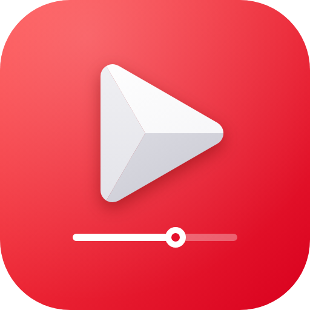

<p align="center">


</p>

<h2 align="center">Youtube Player for Flutter</h2>

<p align="center">
A Flutter monorepo for seamless YouTube video playback, powered by the official <a href="https://developers.google.com/youtube/iframe_api_reference">iFrame Player API</a>.
</p>

<p align="center">
<a href="https://github.com/sarbagyastha/youtube_player_flutter"></a>
<a href="https://github.com/sarbagyastha/youtube_player_flutter/issues"></a>
<a href="https://github.com/sarbagyastha/youtube_player_flutter/blob/main/LICENSE"></a>
</p>

---

## Packages

| Package | Version | Demo | Description | Platforms |
|---|---|---|---|---|
| [youtube_player](packages/youtube_player) | [](https://pub.dev/packages/youtube_player) | | New plain IFrame player on native WebViews (Pigeon Native Interop, no `webview_flutter`). Custom UI via `controlsBuilder`. | Android, iOS, macOS, Web |
| [youtube_player_platform_interface](packages/youtube_player_platform_interface) | [](https://pub.dev/packages/youtube_player_platform_interface) | | Platform interface for `youtube_player` (added automatically) | All |
| [youtube_player_android](packages/youtube_player_android) | [](https://pub.dev/packages/youtube_player_android) | | Android implementation for `youtube_player` (added automatically) | Android |
| [youtube_player_darwin](packages/youtube_player_darwin) | [](https://pub.dev/packages/youtube_player_darwin) | | iOS and macOS implementation for `youtube_player` (added automatically) | iOS, macOS |
| [youtube_player_html](packages/youtube_player_html) | [](https://pub.dev/packages/youtube_player_html) | | Web implementation for `youtube_player` (added automatically) | Web |
| [youtube_player_flutter](packages/youtube_player_flutter) | [](https://pub.dev/packages/youtube_player_flutter) | [](https://yt.sarbagyastha.com.np) | Batteries-included YouTube player with built-in controls, gestures, and live stream UI | Android, iOS, macOS, Web |

---

## Which package should I use?

### `youtube_player`: the new federated player

A from-scratch IFrame player built on a minimal native WebView per platform, driven through Pigeon Native Interop (JNI on Android, FFI on iOS/macOS) with no platform channels and no `webview_flutter`. It draws no Flutter UI of its own; add custom controls through `YoutubePlayer.controlsBuilder`.

```
flutter pub add youtube_player
```

**Best for:** new projects that want a lean, modern player. Requires Dart 3.14+ and Flutter 3.50+.

---

### `youtube_player_flutter`: just want a player that works

The quickest path to YouTube playback in your app, built on top of `youtube_player`. It ships with ready-made controls, a progress bar, drag-to-seek, pinch-to-fullscreen, and a live stream UI, all out of the box. Drop it in, point it at a video ID, and you're done.

```
flutter pub add youtube_player_flutter
```

**Best for:** apps that want a polished, functional player with minimal setup.

---

### Platform packages: you probably don't need to add these

`youtube_player_platform_interface`, `youtube_player_android`, `youtube_player_darwin` and `youtube_player_html` are consumed automatically by `youtube_player`. You only need to add them directly if you're building a platform plugin or working inside this monorepo.

---

## License

BSD-3-Clause. See [LICENSE](LICENSE) for details.

This project uses the [YouTube IFrame Player API](https://developers.google.com/youtube/iframe_api_reference). By using these packages, you agree to the [YouTube API Services Terms of Service](https://developers.google.com/youtube/terms/api-services-tos).

API method documentation is adapted from the [YouTube IFrame Player API Reference](https://developers.google.com/youtube/iframe_api_reference), © Google LLC, licensed under [CC BY 4.0](https://creativecommons.org/licenses/by/4.0/). See [NOTICE](NOTICE) for details.
