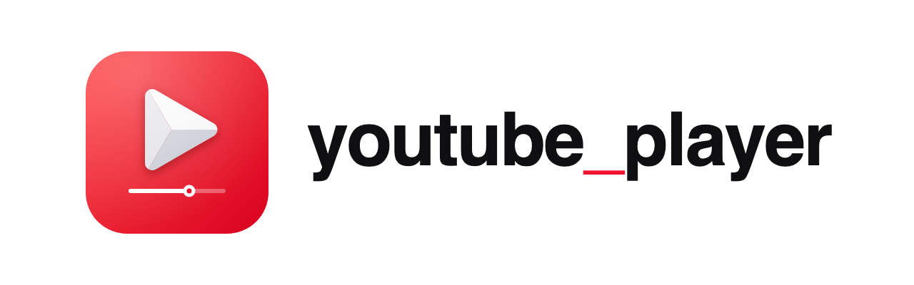

<p align="center">
<picture>
  <source media="(prefers-color-scheme: dark)" srcset="https://raw.githubusercontent.com/sarbagyastha/youtube_player_flutter/main/packages/youtube_player/misc/banner_dark.png">
  
</picture>
</p>

<p align="center">
<b>Play YouTube videos inline in Flutter, with the official
<a href="https://developers.google.com/youtube/iframe_api_reference">IFrame Player API</a>.</b><br>
⚡ Synchronous APIs, native WebViews, no platform channels, no <code>webview_flutter</code>.
</p>

<p align="center">
<a href="https://pub.dev/packages/youtube_player"></a>

<a href="https://github.com/sarbagyastha/youtube_player_flutter/blob/main/LICENSE"></a>
</p>

---

## ✨ Highlights

| | |
|---|---|
| ⚡ **Synchronous APIs** | No `await` in sight. Native interop (JNI, FFI, `js_interop`) replaces platform channels, and player state is cached, so commands return `void` and getters return values ([why?](#-synchronous-thanks-to-native-interop)). |
| 🪶 **Small native hosts** | A plain system WebView on Android, iOS and macOS, driven through [Pigeon](https://pub.dev/packages/pigeon) Native Interop (JNI on Android, FFI on iOS/macOS). Direct calls, no platform channels, no `webview_flutter`. |
| 🌐 **Web & Wasm** | On the web, `YT.Player` is driven directly through `dart:js_interop`. Works with `--wasm` and with cross-origin isolated pages. |
| 🖥️ **System fullscreen** | The fullscreen button uses the platform's own fullscreen. No Flutter-side re-parenting. |
| 🎨 **Bring your own UI** | One `controlsBuilder` hook swaps YouTube's controls for your Flutter widgets. |
| 🪪 **Client identity built in** | Your app id is sent as Referer and origin, as YouTube [requires](https://developers.google.com/youtube/terms/required-minimum-functionality#embedded-player-api-client-identity). Goodbye, error 153. |
| 👀 **Polite autoplay** | Starts only when at least half the player is visible, one player at a time. |
| 🎛️ **Tame the player UI** | Hide YouTube's own buttons, such as the logo, share or watch later (native platforms). |
| 🚦 **Navigation decisions** | Every link or button click asks `onNavigationRequest` first: let it through, block it, or handle it yourself, even asynchronously (native platforms). |
| 🔒 **Privacy first** | Privacy-enhanced mode (`youtube-nocookie.com`) is on by default. |
| 📝 **Captions, playlists, 360°** | Caption size and reload, playlists with loop and shuffle, spherical video controls. |

| Android | iOS | macOS | Web |
|:-:|:-:|:-:|:-:|
| ✅ | ✅ | ✅ | ✅ (JS & Wasm) |

---

## 🧭 The journey

1. [📦 Pack your bags](#-1-pack-your-bags): install and set up
2. [🎬 Press play](#-2-press-play): your first video
3. [🎮 Take the wheel](#-3-take-the-wheel): control playback
4. [📡 Listen in](#-4-listen-in): react to state
5. [🎨 Make it yours](#-5-make-it-yours): custom controls
6. [📺 Go big](#-6-go-big): fullscreen
7. [🧹 Tidy the view](#-7-tidy-the-view): hide elements and decide where clicks go
8. [🧳 Coming from youtube_player_iframe?](#-8-coming-from-youtube_player_iframe)

---

## 📦 1. Pack your bags

```sh
flutter pub add youtube_player
```

**Requirements:** Dart 3.14+ and Flutter 3.50+.

Then a few platform notes:

- 🤖 **Android:** nothing to do. The plugin declares `INTERNET`.
  - ✨ *Optional:* opt in to
    [Hybrid Composition++](https://docs.flutter.dev/platform-integration/android/platform-views#hcpp)
    for the best rendering on API 34+ devices with Vulkan. Add this inside
    `<application>` in `AndroidManifest.xml` (or use `flutter run --enable-hcpp`
    while developing):

    ```xml
    <meta-data
        android:name="io.flutter.embedding.android.EnableHcpp"
        android:value="true" />
    ```

    The player uses HCPP whenever the device supports it and otherwise falls
    back to Texture Layer Hybrid Composition. The flag applies to every
    platform view in the app.
- 🍎 **iOS / macOS:** requires Swift Package Manager (Flutter's default).
  CocoaPods is not supported.
- 💻 **macOS:** enable `com.apple.security.network.client` in your entitlements.
- 🌐 **Web with `--wasm` multithreading (COOP/COEP headers):** set
  `YoutubePlayerParams(webCredentialless: true)`.
- 🪪 **Custom client identity:** set `YoutubePlayerParams(appId: 'com.example.app')`.
  It defaults to the Android application id or Apple bundle id.

## 🎬 2. Press play

```dart
import 'package:youtube_player/youtube_player.dart';

final controller = YoutubePlayerController.fromVideoId(
  videoId: 'M7lc1UVf-VE',
  autoPlay: true,
  params: const YoutubePlayerParams(mute: true),
);

// In build():
YoutubePlayer(controller: controller);

// When done:
controller.close();
```

That's it, you're watching YouTube. 🍿

**👀 About autoplay:** `fromVideoId(autoPlay: true)` waits until at least half
of the player is on screen, and only one player autoplays at a time. This
follows YouTube's Required Minimum Functionality. Set
`YoutubePlayer.autoPlayWhenVisible: false` to start immediately instead.

## 🎮 3. Take the wheel

### ⚡ Synchronous, thanks to native interop

Commands return `void` and getters return plain values. No `await`, and it's
safe to read in `build()`:

```dart
controller.seekTo(seconds: 30, allowSeekAhead: true);
final progress = controller.currentTime / controller.duration;
```

🔬 **Why?** Instead of platform channels (encode, queue, reply, `Future`),
[Pigeon](https://pub.dev/packages/pigeon)'s Native Interop calls straight into
Kotlin over JNI and Swift over `dart:ffi`, and the web uses `dart:js_interop`.
Player state is pushed back the same way and cached, so reads are instant.
Only queries YouTube doesn't push (such as `playlist`, `videoUrl` and
`getOptions`) still return a `Future`.

| | |
|---|---|
| ⏯️ Playback | `playVideo`, `pauseVideo`, `stopVideo`, `seekTo` |
| 📼 Loading | `loadVideoById`, `cueVideoById`, `loadVideoByUrl`, `cueVideoByUrl`, `loadVideo(url)` |
| 📚 Playlists | `loadPlaylist`, `cuePlaylist`, `nextVideo`, `previousVideo`, `playVideoAt`, `setLoop`, `setShuffle` |
| 🔊 Sound | `mute`, `unMute`, `setVolume` (check `supportsVolume`: iOS only allows the hardware buttons) |
| 🐇 Speed | `setPlaybackRate`, `playbackRate` |
| 💬 Captions | `setCaptionsFontSize`, `reloadCaptions` |
| 🌍 360° video | `sphericalProperties`, `setSphericalProperties` |
| 🖼️ Thumbnails | `YoutubePlayerController.getThumbnail(videoId: ...)` |

## 📡 4. Listen in

```dart
controller.videoStateStream.listen((state) => print(state.position));
```

- 🧱 Rebuild widgets with `YoutubeValueBuilder`.
- 🌳 Share a controller with a subtree via `YoutubePlayerControllerProvider`,
  then read it with `context.ytController`.
- 🚦 `value.isReady`, `value.isAutoplayBlocked` and `value.isFullScreen` tell
  you what the player is up to.
- 🧯 `onLoadError(YoutubeLoadError)` reports pages that fail to load.

## 🎨 5. Make it yours

Pass `controlsBuilder` to replace YouTube's controls with Flutter widgets:

```dart
YoutubePlayer(
  controller: controller,
  controlsBuilder: (context, value) => MyControls(value),
);
```

You don't need to set any params. With a `controlsBuilder`, the player is
created with its native controls, keyboard shortcuts and fullscreen button
turned off, and the iframe ignores pointer events, so every tap reaches your
overlay. The overlay covers exactly the player's `aspectRatio` box. It
rebuilds on every value change, and `context.ytController` works inside it.

> [!TIP]
> - The controls are fixed when the player is created, so decide on
>   `controlsBuilder` before the player is first shown.
> - The overlay is not shown in native fullscreen. A custom fullscreen button
>   can call `enterFullScreen()` on Android, macOS and the web; iPhone only
>   allows the player's own button.

## 📺 6. Go big

The fullscreen button (`showFullscreenButton`, on by default) uses the
platform's own fullscreen: WebKit on iOS/macOS, a custom view on Android, the
browser on the web. `controller.value.isFullScreen` and
`setFullScreenListener` reflect it.

`enterFullScreen()` returns whether the platform accepted the request. Some
platforms only allow fullscreen from a user gesture, and iPhone only allows it
from the player's own button. On Android, `YoutubePlayerParams.fullscreenOrientation`
controls rotation.

## 🧹 7. Tidy the view

🔗 When the user taps the title, logo, channel or a share link, the link opens
externally. A related or end-screen video loads in place instead.

### 🙈 Hide elements

On Android, iOS and macOS you can hide parts of YouTube's own player UI:

```dart
final controller = YoutubePlayerController.fromVideoId(
  videoId: 'tcodrIK2P_I',
  // Asked once per element when the player is created.
  elementVisibility: (element) => element != PlayerElement.watchLaterButton,
);

// Later, at runtime:
controller.setElementVisible(PlayerElement.title, false);
```

`PlayerElement.values` lists the built-in elements: logo, title, channel,
share, watch later, copy link, more videos, related videos, end screen, cards
and more. Use `PlayerElement.custom('<css selector>')` for anything else, and
add it to `YoutubePlayerParams.customElements` so clicks on it are recognised.

### 🚦 Decide where clicks go

`onNavigationRequest` is asked before a link or button click goes anywhere.
Each `NavigationRequest` tells you which `element` was clicked and the `uri` it
leads to (`null` for in-player buttons such as share). Answer with a
`NavigationDecision`:

| Decision | What happens |
|---|---|
| ✅ `NavigationDecision.navigate` | The default: a related video loads in place, other links open externally, buttons act as usual. |
| ⛔ `NavigationDecision.prevent` | The click is blocked. Return this after handling the click yourself. |

The handler can be `async`, so you can ask the user or open your own screen
first:

```dart
final controller = YoutubePlayerController.fromVideoId(
  videoId: 'tcodrIK2P_I',
  onNavigationRequest: (request) async {
    // Keep users in the app when they tap the logo.
    if (request.element == PlayerElement.youtubeLogo) {
      return NavigationDecision.prevent;
    }
    // Open other links in your own in-app browser.
    if (request.uri case final uri?) {
      await openInAppBrowser(uri);
      return NavigationDecision.prevent;
    }
    return NavigationDecision.navigate;
  },
);
```

Notes:

- The elements are matched by YouTube's undocumented CSS classes, so a
  built-in element can stop matching when YouTube changes its player.
- On the web, the player is a cross-origin iframe that the page cannot reach
  into. Both hooks are ignored there, and links open in a new tab.

> [!WARNING]
> YouTube's [API terms](https://developers.google.com/youtube/terms/required-minimum-functionality)
> restrict obscuring the player's branding. Hiding elements is at your own risk.

## 🧳 8. Coming from youtube_player_iframe?

This package is the planned successor to `youtube_player_iframe`. Most code
only needs the import changed to `package:youtube_player/youtube_player.dart`.

<details>
<summary><b>🗺️ Full migration map</b></summary>

| youtube_player_iframe | youtube_player |
|---|---|
| `controller.webViewController`, `package:youtube_player_iframe/webview.dart` | Removed; there is no `webview_flutter`. |
| `onWebResourceError` | `onLoadError(YoutubeLoadError)` |
| `YoutubePlayerScaffold`, orientation lists, `autoFullScreen`, `enableFullScreenOnVerticalDrag` | Removed; fullscreen is native. |
| `value.fullScreenOption.enabled` | `value.isFullScreen` |
| `enterFullScreen({lock})` | `Future<bool> enterFullScreen()` |
| `YoutubePlayer(userAgent:)` | `YoutubePlayerParams(userAgent:)` |
| `YoutubePlayerParams(color: 'white')` | `color: .white` (`ProgressBarColor`) |
| `YoutubePlayerParams(enableJavaScript:)` | Removed (always on). |
| `cuePlaylist(list:, listType: ListType.playlist)` | `ListType` has `playlist` and `userUploads` (`search` was removed by YouTube). |
| `getCurrentPositionStream()` | `videoStateStream` |
| `YoutubeError.sameAsNotEmbeddable*` | Merged into `notEmbeddable`; new `missingClientIdentity` (153). |
| `showFullscreenButton` defaulted to `false` | Defaults to `true`. |
| `YoutubePlayerThumbnail` / player thumbnail placeholder | Removed; build one with `getThumbnail`. |
| `showControls: false` + `pointerEvents: none` for custom controls | Pass `YoutubePlayer(controlsBuilder:)`; it sets both. |
| Player created on the first controller call | Created when a `YoutubePlayer` first shows it; earlier calls are queued. |
| Commands (`playVideo()`, `seekTo()`, `mute()`, …) and `close()` return `Future<void>` | They return `void`; drop the `await`. |
| `await controller.currentTime`, `volume`, `isMuted`, `playbackRate`, `playerState`, `duration`, `videoLoadedFraction`, `videoData` | Synchronous getters. Queries such as `playlist` and `videoUrl` still return a `Future`. |

</details>

🆕 **New in this package:** `setCaptionsFontSize`, `reloadCaptions`,
`getOptions`, `sphericalProperties` / `setSphericalProperties`,
`apiChangeStream`, `value.isAutoplayBlocked`, `value.isReady`.

---

<p align="center">
🏁 <b>You made it!</b> Found a bug or have an idea?
<a href="https://github.com/sarbagyastha/youtube_player_flutter/issues">Open an issue</a> 💬
</p>
